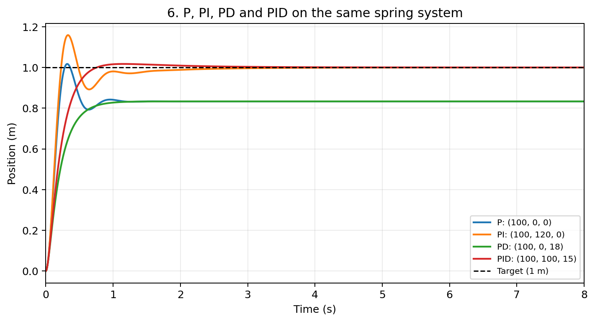

# PID Control — Simulation and Analysis

A Python project that demonstrates how PID controllers move a physical system toward a desired position and keep it there. It uses a mass–spring–damper model to explain proportional, integral and derivative control through numerical simulations and graphs.

The controller is implemented from scratch using **Python, NumPy and Matplotlib**, without any control-system libraries.



*Figure: Comparison of four controllers tracking a 1 m position target.*

## What is PID control?

A PID controller continuously compares the desired value (setpoint) with the measured value and calculates a correction based on three terms:

| Term | Role |
|---|---|
| **P — Proportional** | Reacts to the current error. |
| **I — Integral** | Accumulates past error to remove persistent tracking error. |
| **D — Derivative** | Reacts to the rate of change to help reduce oscillations. |

The control law is:

$$
u(t) = K_p e(t) + K_i \int_0^t e(\tau)\,d\tau + K_d \frac{de(t)}{dt}
$$

where $e(t)=r(t)-x(t)$, $r$ is the target, and $x$ is the measured position. In the practical implementation, the derivative is calculated from the measurement by default to avoid derivative kick.

## Quick start

**Requirements:** Python 3.11–3.14, NumPy and Matplotlib.

Clone or download this repository and open a terminal in the project directory.

### Windows (PowerShell)

```powershell
python -m venv .venv
.\.venv\Scripts\python.exe -m pip install -r requirements.txt
.\.venv\Scripts\python.exe run_experiments.py
```

### Linux / macOS

```bash
python3 -m venv .venv
.venv/bin/python -m pip install -r requirements.txt
.venv/bin/python run_experiments.py
```

Running the experiment runner generates all **11 figures** in `graphs/` and saves the controller comparison to `results.csv`. No interactive plot windows are required.

To run one experiment instead, use the virtual environment's Python interpreter:

```powershell
.\.venv\Scripts\python.exe -m experiments.exp06_windup
```

On Linux/macOS, use `.venv/bin/python` in place of `.\.venv\Scripts\python.exe`.

## Simulation model

The primary system is a 1 kg block attached to a spring and a damper. The goal is to move it from rest to a position of 1 m.

$$
m\ddot{x}+b\dot{x}+kx=F
$$

| Parameter | Value |
|---|---|
| Mass ($m$) | 1 kg |
| Damping ($b$) | 10 N·s/m |
| Spring stiffness ($k$) | 20 N/m |
| Target position | 1 m |
| Initial position and velocity | 0 m, 0 m/s |

The spring requires a constant holding force of 20 N at the target. Proportional control alone therefore leaves a nonzero steady-state error; integral action supplies the holding force needed for accurate tracking.

The physical model is integrated using fourth-order Runge–Kutta (RK4), with substeps no larger than 0.002 s. The controller normally updates every 0.01 s, holding its output constant between updates.

A second system, $G(s)=1/(s+1)^3$, is used to study Ziegler–Nichols tuning.

## Experiments

Each experiment is a separate Python module and generates one standalone figure. Click a figure link to view the result.

| Experiment | What it demonstrates | Figure |
|---|---|---|
| [01 — Step response](experiments/exp01_step_response.py) | Rise time, overshoot, settling time and steady-state error | [View](graphs/04_metrics.png) |
| [02 — Proportional](experiments/exp02_proportional.py) | Four P gains and theoretical equilibrium error | [View](graphs/05a_p_only.png) |
| [03 — Integral](experiments/exp03_integral.py) | Elimination of persistent error | [View](graphs/05b_integral.png) |
| [04 — Derivative](experiments/exp04_derivative.py) | Reduction of overshoot through damping | [View](graphs/05c_derivative.png) |
| [05 — Comparison](experiments/exp05_comparison.py) | P, PI, PD and PID performance | [View](graphs/06_comparison.png) |
| [06 — Windup](experiments/exp06_windup.py) | ±30 N saturation and anti-windup | [View](graphs/07a_windup.png) |
| [07 — Sensor noise](experiments/exp07_sensor_noise.py) | ±1 mm noise and derivative filtering | [View](graphs/07b_noise.png) |
| [08 — Derivative kick](experiments/exp08_derivative_kick.py) | Setpoint-induced force spikes and prevention | [View](graphs/07c_kick.png) |
| [09 — Sampling time](experiments/exp09_sampling_time.py) | Effect of slow controller updates | [View](graphs/07d_sampling.png) |
| [10 — Ultimate gain](experiments/exp10_ziegler_nichols.py) | Sustained oscillations and ultimate period | [View](graphs/08a_ultimate_gain.png) |
| [11 — PID tuning](experiments/exp11_improved_tuning.py) | Ziegler–Nichols tuning and manual improvement | [View](graphs/08b_zn_tuning.png) |

## Key results

### Controller comparison

| Controller | Kp | Ki | Kd | Rise (s) | Overshoot | Settling (s) | Error (m) |
|---|---:|---:|---:|---:|---:|---:|---:|
| P | 100 | 0 | 0 | 0.1777 | 1.74% | N/A | 0.1667 |
| PI | 100 | 120 | 0 | 0.1538 | 15.90% | 1.50 | ≈ 0 |
| PD | 100 | 0 | 18 | N/A | 0% | N/A | 0.1667 |
| **PID** | **100** | **100** | **15** | **0.4043** | **1.73%** | **0.65** | **≈ 0** |

The selected PID gains are **Kp = 100, Ki = 100 and Kd = 15**. They achieve low overshoot, fast settling and negligible tracking error in the ideal spring-system simulation. See [results.csv](results.csv) for the numerical comparison.

Rise time measures the 10–90% target crossing, settling time uses a ±2% target band, and steady-state error is estimated from the final 5% of recorded samples. N/A indicates that the required threshold or settling condition was not achieved during the simulation. The ideal comparison uses no actuator limit.

### Practical control challenges

| Problem | Solution | Simulation result |
|---|---|---|
| Integral windup | Conditional integration | Overshoot: 25.44% → 7.71% |
| Sensor noise | Low-pass derivative filter | Derivative-force fluctuations reduced by 88.08% (standard deviation) |
| Derivative kick | Derivative on measurement | Setpoint-induced spike: 1500 N → 0 N |
| Slow updates | Faster controller sampling | Overshoot: 13.17% at 0.15 s → 1.73% at 0.01 s |

For the third-order system, the sampled ultimate gain is 7.8822 and the measured oscillation period is 3.652 s. Manual tuning reduces overshoot from 52.19% to 21.05% and settling time from 9.91 s to 5.03 s relative to the sampled Ziegler–Nichols PID.

[View tuning comparison](graphs/08b_zn_tuning.png).

## Project structure

```text
pid-control/
├── pid_controller.py    # PID calculations and practical safeguards
├── plant.py             # Plant models, RK4 and simulation
├── metrics.py           # Step-response performance measures
├── experiments/        # 11 independent experiments and shared plotting
├── graphs/             # Generated figures
├── tests/              # Numerical and controller tests
├── run_experiments.py   # Run all experiments
├── results.csv          # Controller comparison data
└── requirements.txt    # Pinned dependencies
```

## Try your own controller

Import the reusable controller and plant, then change the gains or physical parameters to explore their effects.

```python
from pid_controller import PIDController
from plant import MassSpringDamper, simulate
from metrics import response_metrics

controller = PIDController(
    kp=100, ki=100, kd=15, dt=0.01,
    output_limits=(-30, 30),
    anti_windup=True,
    derivative_on_measurement=True,
    derivative_filter_tau=0.05,
)

plant = MassSpringDamper(mass=1, damping=10, spring=20)
run = simulate(controller, plant, duration=8, noise_amplitude=0.001)

print(response_metrics(run))
```

This configuration includes actuator limits, anti-windup, derivative filtering and noisy measurements. The simulator returns time, position, velocity, applied force and the individual PID contributions. All results are numerical simulations, not hardware measurements.

## Tests

Run the 13 numerical tests using the same Python environment:

```bash
python -m unittest discover -s tests -v
```

The tests cover PID arithmetic, theoretical equilibrium positions, saturation, derivative kick, noise filtering, tuning and combined practical-controller performance. The fixed random seed makes the noise experiments reproducible.

## References

- [Feedback Systems — Åström and Murray](https://fbsbook.org/)
- [NumPy documentation](https://numpy.org/doc/)
- [Matplotlib documentation](https://matplotlib.org/stable/)
